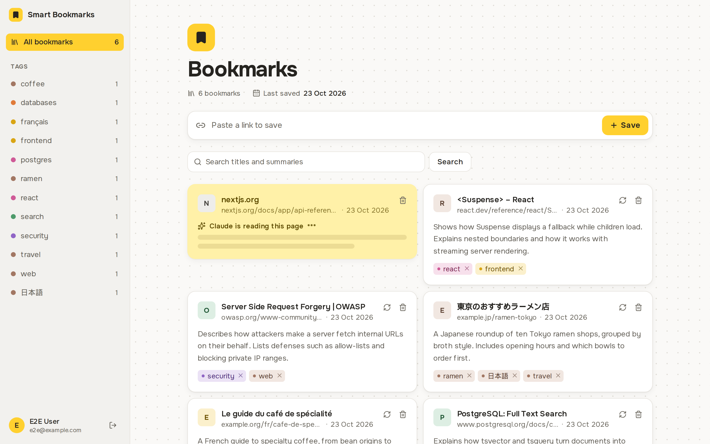
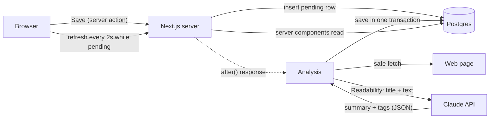

# Smart Bookmarks

Paste a link, and Claude reads the page for you: a two-sentence summary and a few tags, ready to filter and search.

**Live:** [smart-bookmarks-livid.vercel.app](https://smart-bookmarks-livid.vercel.app/) (sign in with GitHub)

## What it does

- **Save a link.** The bookmark appears instantly as a yellow sticky while Claude reads the page in the background.
- **Summary and tags.** Claude writes a two-sentence summary and picks 3–5 tags, reusing tags you already have so the list stays tidy.
- **Filter and search.** Click a tag in the sidebar, or search titles and summaries in any language. Filters live in the URL, so a view can be bookmarked or shared.
- **Edit.** Add or remove tags by hand, re-analyze a page, or delete a bookmark.
- **Private by default.** Each user only ever sees their own bookmarks.

## Highlights

**Fetching user-given URLs safely (SSRF).** The server fetches whatever link a user pastes, so a careless version could be tricked into requesting `http://localhost`, a cloud metadata address, or a private network. Before every request, and again on every redirect, the hostname is resolved and rejected unless every address is public. Redirects are followed by hand (at most 5), with an 8-second timeout, a 2 MB size cap and HTML-only responses. These guards have their own tests with mocked DNS.

**Save first, analyze later.** Fetching a page and calling an AI model takes seconds, so saving doesn't wait for it. The save writes a `pending` row and returns at once; the analysis runs after the response with Next.js `after()`. While anything is pending, the page refreshes every 2 seconds, and the sticky settles into a white card when the summary lands.

**Treating AI input and output as untrusted.** Page text could contain instructions aimed at the model, so the system prompt says page content is data, never commands. The reply is requested as structured JSON and still validated with Zod, with one retry. Tags are cleaned (Unicode-aware, normalised, length-capped) before they touch the database.

**Search in any language.** Search uses Postgres full-text search, with title matches ranked above summary matches. Accents are stripped on both sides, so `cafe` finds `café`. Japanese and Chinese are written without spaces, which defeats word-based search, so a substring match backed by a trigram index runs alongside it: `日本語` finds `日本語の記事です`.

**Tests against real infrastructure.** Unit tests (Vitest) cover URL handling, tag cleaning, the SSRF guard and AI reply parsing. Playwright tests run the production build against a real Postgres database, covering saving, filtering, multilingual search and deletion end to end.

## Architecture

Pages are React Server Components that read straight from Postgres; changes go through server actions, and every query is scoped to the signed-in user from the session, never to an ID sent by the browser. The analysis step fetches the page, extracts the readable text, trims it to 8,000 characters, asks Claude for a summary and tags, and saves the result and its tags in a single database transaction.

## Tech stack

| Area         | Choice                                                                     |
| ------------ | -------------------------------------------------------------------------- |
| App          | Next.js (App Router, Server Components, server actions), React, TypeScript |
| Styling      | Tailwind CSS, Onest, lucide icons                                          |
| Database     | Postgres on Neon, Drizzle ORM and migrations                               |
| Auth         | Better Auth with GitHub sign-in                                            |
| AI           | Claude (Haiku) through the Anthropic SDK, structured outputs, Zod          |
| Page reading | Mozilla Readability on linkedom                                            |
| Testing      | Vitest, Playwright                                                         |
| Hosting      | Vercel                                                                     |

## How it's tested

Unit tests cover the pieces where a mistake would be silent: URL normalisation, tag cleaning, the SSRF guard (private and loopback ranges, cloud metadata, IPv6 tricks, with DNS mocked) and parsing of the AI's reply, including malformed answers.

End-to-end tests build and start the real app, sign in a test user, and drive it in Chromium against a local Postgres database. They cover saving a link and seeing it analyzed, filtering by tag, searching (including accented, Cyrillic and Japanese text), deleting, and the signed-out screen. AI calls run in a fake mode, so the tests are fast, free and repeatable.

## Known limitations

- **DNS rebinding.** The URL check resolves DNS, then `fetch` resolves it again, so a hostile DNS server could answer differently the second time. The fix is to connect to the exact IP that was checked.
- **Re-analyze replaces tags.** Re-analyzing a bookmark replaces all its tags, including ones added by hand.

## More

- [`PRODUCT.md`](PRODUCT.md): who it's for and why
- [`DESIGN.md`](DESIGN.md): the visual design system
